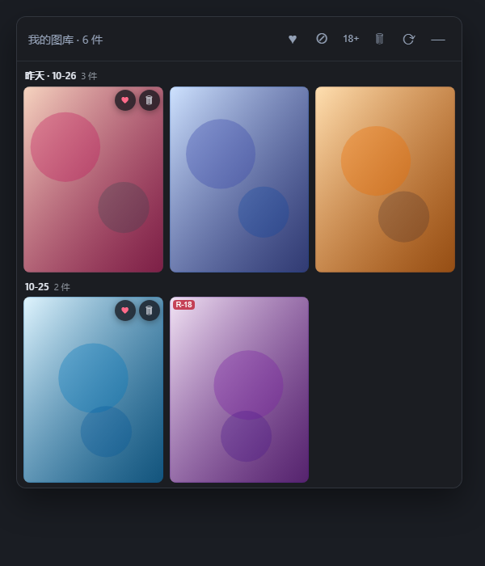
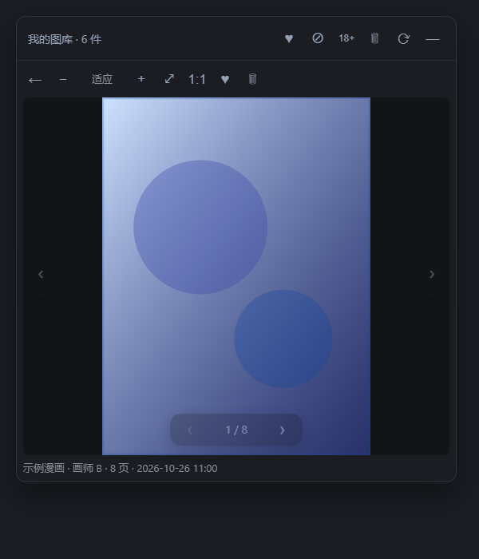
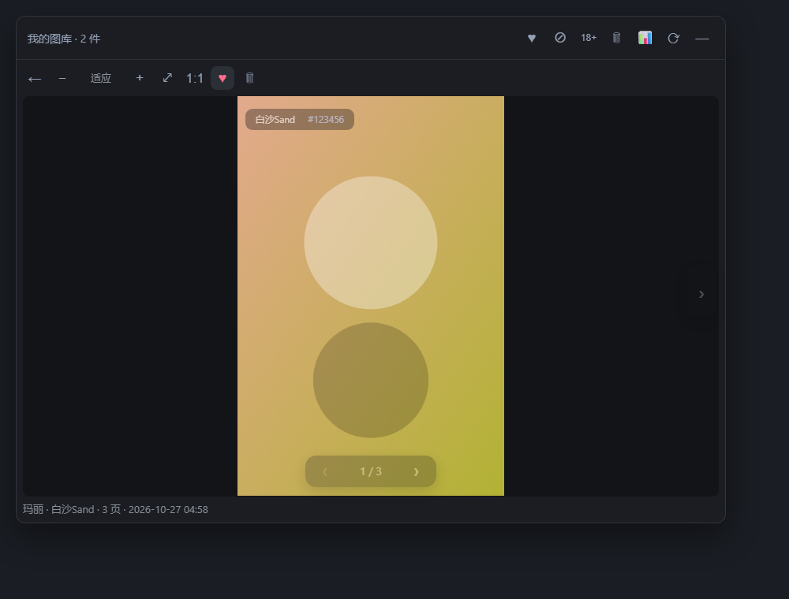

# dsh-gallery · 图库

一个 DSH 插件：**把你本地的图片文件夹当图库来翻**。

缩略图墙、喜好标记、垃圾桶（可还原）、R18 过滤、多图翻页、缩放拖动看图——都在 DSH 右上角的一个小图标里。







> 截图里的图是示意色块，不是真图。显示名可以自己改（默认「我的图库」），装完进 **设置 → 图库** 改就行。

---

## 装

直接从 GitHub 装：

```bash
dsh plugin add github:AzumaRyu-dsh/dsh-gallery
```

或者把仓库 clone 到本地，用路径装：

```bash
dsh plugin add link:<仓库所在目录的绝对路径>
```

装完 **重启一次 DSH**（bundle 层要重启才组装）。之后右上角会出现一个图片图标，点开就是图库。

卸载：`dsh plugin remove dsh-gallery`，再重启。

要求：DSH ≥ 0.2.1-rc.2，Node ≥ 22.19。**不需要 Python，不需要登录任何账号。**

## 用

第一次打开是空的，进 **设置 → 图库** 填**图库目录**（比如 `D:\Pictures\我的图库`），保存后刷新面板即可。

### 面板里能做什么

| 操作 | 怎么用 |
|---|---|
| 看大图 | 点缩略图 |
| 缩放 | 滚轮（以鼠标位置为锚点）/ 工具栏 `+ −` / 双击切换适应 |
| 拖动看细节 | 放大后按住图拖，四个方向都能拖 |
| 多图翻页 | 图片底部浮着 `‹ 2 / 10 ›`，鼠标不靠近时是淡的 |
| 切上一个 / 下一个作品 | 看图区左右两侧的大箭头，鼠标移进看图区才清晰 |
| 喜好 | 缩略图右上角 ♥，或看图工具栏的 ♥，或右键菜单 |
| 删除 | 缩略图右上角 🗑 —— **先进垃圾桶**，6 秒内可点「撤销」 |
| 只看喜好 | 标题栏 ♥ |
| 隐藏 / 只看 R18 | 标题栏 ⊘ / `18+`（两个互斥，再点回到全部） |
| 垃圾桶 | 标题栏 🗑：逐件「还原 / 彻底删除」，也能清空 |
| 改窗口大小 | 拖面板的四边四角；位置固定在右上角 |

### 两种目录模式（自动判断）

**① 作品模式** —— 目录里有 `<图库>/_meta/*.json`
每个 json 是一件作品，图片路径、页序、标题、画师、分级、喜好都从里面读。
（刷 Pixiv 那个插件存下来的就是这个形状，两个插件天然配合，互不依赖。）

**② 纯图片模式** —— 没有 `_meta`
目录里的图片文件直接当作品，一张一件；路径里含 `R-18` / `R18` 的自动认作 R18；喜好存在插件家目录的 `state.json`。

```
图库/
├─ _meta/          作品元数据（有它就走作品模式）
├─ _trash/         垃圾桶（删除的东西挪这儿，还原后自动清掉）
└─ 任意子目录/图片
```

### 和刷 Pixiv 的关系

**没有代码依赖。** 刷 Pixiv 存完图，图库面板开着的话 20 秒内会自动出现新图；
其它插件也可以用 `POST /gallery/api/notify` 立刻催它刷新。

## 安全与边界

- 只会读写**图库目录之内**的文件；`metadata.dir` 指到目录外的，一律拒绝。
- 删除 = 挪进 `<图库>/_trash/`，**不是**直接抹掉；只有点「彻底删除 / 清空」才真删。
- 图片只经 `` 读取，服务端有越界校验（`resolve` 后必须仍在图库根目录下）。
- 配置和状态在 `$DSH_HOME/gallery/`（`config.json` / `state.json`），**不写进插件包目录**。

## 配置

`$DSH_HOME/gallery/config.json`（也可以在设置页改）：

| 键 | 默认 | 说明 |
|---|---|---|
| `title` | `我的图库` | 面板标题 |
| `root` | 空 | 图库根目录；空 = 插件家目录下的 `library/` |
| `metaDir` | `_meta` | 作品元数据目录名 |
| `trashDir` | `_trash` | 垃圾桶目录名（放在图库根目录里） |
| `pageLimit` | `120` | 一次最多列多少件 |

## 已知限制

- 图库目录得手动填一次（还没有「选文件夹」的图形对话框）。
- 纯图片模式没有画师 / 页数信息，喜好只能记在插件家目录。
- 面板位置固定右上角，只能改大小。

## 开发

```
lib/index.js    宿主入口（配置 + 注册路由）
lib/config.mjs  配置读写、默认值、路径钳制
lib/gallery.mjs 列表 / 喜好 / 删除进垃圾桶 / 还原 / 彻底删除
lib/http.mjs    双通道接口（connection.fetch + webServer 前缀）与图片路由
lib/client.js   浏览器半端（面板、看图、筛选、垃圾桶）
```

接口：`/api/gallery/{ping,config,gallery,gallery/fav,gallery/delete,gallery/trash,gallery/restore,gallery/purge,notify}`

## 许可

MIT
